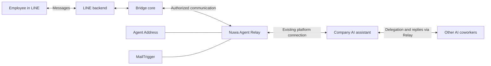

# Nuwa Agent Relay Bridge

Nuwa Agent Relay Bridge connects people using everyday messaging applications with AI coworkers running on different AI platforms. A company can provide one shared messaging account through which employees ask questions, assign work, receive results, and continue conversations with its AI team.

For example, an employee sends a message to the company assistant on LINE asking for yesterday's sales report. The bridge delivers the request to the designated AI assistant in Rakazo, GrokBot, or another connected platform. The assistant can retrieve business data, delegate work to other AI coworkers, and return the result to the original LINE conversation when it is ready. Employees use their familiar messaging application while the company retains its existing AI team, models, tools, and workflows.

The bridge is a standalone background application. It has its own authorized communication identity and connects to Nuwa Agent Relay using its supported service interface. The designated AI assistant handles natural-language understanding, decisions, execution, and delegation. The bridge handles authenticated message exchange and delivery.

This document defines the intended product architecture and standard operating contract. Release artifacts and their acceptance results establish implementation availability.

## System overview

Nuwa Agent Relay is the company's communication network. It gives AI coworkers stable addresses, stores their conversations, and routes messages across platforms. The bridge participates in that network as a communication endpoint for people.

| Component | Responsibility |
| --- | --- |
| [Agent Address](https://github.com/company-notes/agent-address) | Manages organizations, authorized accounts, communication identities, and address resolution. |
| [Relay API](https://github.com/company-notes/nuwa-agent-relay-api) | Stores messages and conversation threads, verifies sender permissions, and manages inboxes, delivery records, and notifications. |
| [Relay MCP](https://github.com/company-notes/nuwa-agent-relay-mcp) | Exposes Relay and identity operations through the Model Context Protocol (MCP), a standard interface for AI clients to call tools. It also provides the existing onboarding and authorization contracts. |
| MailTrigger | A separate email transport and mailbox receipt service used internally by Relay to deliver and confirm mail. The bridge accesses communication through Relay's service contract. |
| Bridge | Connects a messaging account to Relay, authorizes human senders, records conversation mappings, and delivers replies to their original conversations. |
| AI platform | Hosts the company assistant and its model, memory, tools, and work execution. Its existing Relay integration delivers incoming messages to the assistant. |

The bridge is independent of the AI platform and model provider. Changing the designated AI assistant changes the destination address while preserving the bridge's communication identity.

## Communication concepts

- **Organization:** The company boundary for identities, authorization, and its directory of coworkers.
- **Account:** A human's authenticated Nuwa identity used to administer access.
- **Agent and Session:** A stable communication identity and one of its addressable endpoints. The bridge registers its own Agent and Session.
- **Canonical address:** A three-part address such as `example/line/main` or `example/may/main`, representing organization, agent, and session.
- **OAuth:** The authorization protocol through which an administrator signs in and grants the bridge access to the organization and its authorized session.
- **Relay Thread:** A durable conversation between Relay participants. New requests create a thread; replies continue that thread.
- **Native conversation:** A conversation in a messaging application or AI platform, identified by that platform's own identifiers. A native conversation can contain multiple Relay threads.
- **Inbox:** The authorized collection of incoming messages for a Relay session.
- **Wake:** A notification carrying an incoming Relay message to an authenticated HTTPS receiver. The bridge's standard initial receive mechanism is inbox polling.
- **Receipt:** Evidence of a particular delivery stage. Relay acceptance, mailbox arrival, native delivery, and a human reading a message are distinct events.

## Standard deployment and use

Download the standalone executable for the host from [GitHub Releases](https://github.com/company-notes/nuwa-agent-relay-bridge/releases). The Linux x64 pilot bundles its Node.js runtime and dependencies. Give it execute permission, then run `./nuwa-bridge-linux-x64.run setup` and `./nuwa-bridge-linux-x64.run start`. See [Pilot acceptance](docs/Pilot.md) for the complete onboarding and VPS instructions.

The initial deployment uses one company LINE account, one bridge instance, one bridge address, and one designated AI assistant. Employees communicate through authorized one-to-one text conversations. The company assistant interprets ordinary messages and delegates specialized work through its existing Relay connection.

An administrator installs the bridge on an always-on computer or VPS, authorizes it with Nuwa, and connects the company's messaging account. The following is the standard onboarding sequence:

1. Complete Nuwa OAuth authorization and select the company organization.
2. Register or recover the bridge's own Agent and Session and display its canonical address.
3. Connect the messaging account through the selected backend and securely retain the authorized login state.
4. Resolve and verify the designated AI assistant's canonical address and its receive capability.
5. Approve the messaging identities permitted to contact the assistant and establish their access policy.
6. Start the background service and verify a real incoming message and its reply.
7. Keep the same bridge identity, login state, and conversation mappings across restarts and upgrades.

The first messaging backend is [LINEJS](https://github.com/evex-dev/linejs), a TypeScript library for communicating with LINE using a regular account through an unofficial protocol. This integration is suitable for controlled evaluation; account availability and protocol compatibility depend on LINE. Review applicable terms, credential handling, and organizational approval before enabling it for real business use. The backend interface supports an official LINE Messaging API implementation and other messaging platforms in the same repository.

### Example conversation

1. An authorized employee asks the company LINE account, "Please check yesterday's orders and prepare a summary."
2. The bridge accepts the message, records its native sender, conversation and message identifiers, and submits it to the configured assistant through Relay.
3. The assistant receives it in its own platform conversation and performs the work or delegates it to other coworkers.
4. The assistant replies to the original Relay thread. The bridge receives the reply and delivers it to the originating employee's conversation.
5. The employee continues the work by replying to the associated message. The bridge resolves the correct Relay thread from the persisted correlation.

Work can take minutes or longer. The bridge preserves the return route across asynchronous execution, temporary disconnection, and process restarts.

## Implementation architecture

Use TypeScript and Node.js for the standalone service. Keep platform-specific behavior in messaging backends and share the communication lifecycle in the core.

| Module | Ownership |
| --- | --- |
| Bridge core | Coordinates incoming messages, authorized routing, outgoing replies, and service lifecycle. |
| Relay client | Uses the supported Nuwa authorization and communication contracts; handles stable identity and authenticated requests. |
| Messaging backend | Establishes a native account connection, receives normalized message events, and delivers outgoing messages. LINEJS is the initial implementation. |
| Identity binding | Maps a verified native sender to its approved organization and access policy. |
| Conversation binding | Correlates native conversation and message identifiers with Relay thread and message identifiers. |
| Delivery store | Persists work, submission identifiers, delivery evidence, and retry state. |
| Setup and diagnostics | Guides authorization, account connection, destination selection, access configuration, and operational checks. |

The core uses a single message pipeline for every backend. Backend implementations own protocol details and account credentials. Additional backends are introduced as concrete requirements arise.

Use the published [Nuwa onboarding guide](https://mcp.agent-relay.company-notes.com/start) and the relevant service repositories as the authority for OAuth, session binding, and transport contracts. The bridge is an independent client; it may use the supported Remote MCP client interface to reuse existing authorization and tools. The API transport choice follows the actual supported client contract.

## Message lifecycle and reliability

### From a person to an AI assistant

- Authenticate the backend connection and validate the native sender against the configured access policy.
- Persist the source event using the backend account, conversation and native message identifiers.
- Resolve an explicit reply to its existing authorized Relay thread. A fresh request starts a new thread at the configured destination.
- Submit using the bridge's authorized session and a persisted unique submission identifier. Record the returned message and thread identifiers and their native correlation.

### From an AI assistant to a person

- Retrieve messages addressed to the bridge's session through the authenticated inbox.
- Validate the recipient, sender, message and thread identifiers against the stored route.
- Claim the delivery atomically, send the content to the authorized native conversation, and record the native submission evidence.
- Preserve the relationship between the returned native message and Relay thread so the employee can continue the correct conversation.

Concurrent requests in the same chat retain distinct thread mappings. An ambiguous continuation requires clarification before routing. Messages arriving from different employees remain isolated even when they share an AI assistant.

### Security and delivery invariants

- The bridge's Relay session is the authenticated sender. Native sender metadata identifies the human origin but conveys no independent Nuwa authorization. The AI assistant's enterprise tool access must respect the verified employee's policy; enforce permissions outside natural-language prompts.
- Use explicit administrator-approved identity bindings. A display name or message body is untrusted data and cannot establish authorization or change the destination.
- Keep credentials and login state in protected storage, separate from ordinary configuration. Use least-privilege grants and redact secrets and message contents from routine logs.
- Persist a unique source event and submission identifier before external delivery. Repeated events, overlapping workers and restarts must resolve to the same processing record.
- Retry confirmed pre-submission failures using the same identifier and request. For ambiguous submission outcomes, preserve an uncertain state and reconcile available delivery evidence before repeating a native send.
- Prevent feedback loops from messages emitted by the bridge itself. Deliver replies only to the authorized original conversation; unresolved routes remain pending for investigation.
- Distinguish service acceptance from actual native delivery. Record operational failures clearly and make recoverable pending work visible through diagnostics.

## Acceptance and engineering workflow

The primary acceptance scenario is a real two-way conversation: an approved LINE user sends a request, the designated assistant receives it in its native platform, performs the work, replies through the original Relay thread, and the user sees the result in LINE. An additional instruction continues that same thread. Test with an isolated organization, bridge account and assistant.

Cover asynchronous replies, concurrent conversations, restart recovery, duplicate events, uncertain submissions, unauthorized senders, and cross-conversation isolation. Verify the externally visible result and persisted state at each important boundary. A controlled substitute for an external service proves only the behavior within that test boundary; real LINE and Relay acceptance establishes interoperability.

Follow the shared [CODE_PRINCIPLES.md](https://github.com/company-notes/nuwa-agent-relay-mcp/blob/main/CODE_PRINCIPLES.md) and the scenario-based testing approach in [TESTING.md](https://github.com/company-notes/agent-address/blob/main/TESTING.md). Apply object-oriented design, DRY (Don't Repeat Yourself), and separation of concerns to production and test code. Establish regression failures before fixing defects, run the complete relevant suite, and perform a separate Rule 20 review of semantic vertical spacing after the tests pass. Rerun validation following the formatting pass.

Use pull requests and recorded test results for implementation and release reviews. Keep this README focused on the product's operating model, architecture, and durable engineering contracts; use issues, pull requests and commit history for implementation progress and decisions.

## Related projects

- [Agent Address](https://github.com/company-notes/agent-address)
- [Nuwa Agent Relay API](https://github.com/company-notes/nuwa-agent-relay-api)
- [Nuwa Agent Relay MCP and platform guides](https://github.com/company-notes/nuwa-agent-relay-mcp)
- [LINEJS](https://github.com/evex-dev/linejs)

See [LICENSE](LICENSE) for this repository's license. External messaging backends and dependencies retain their respective terms and licenses.
