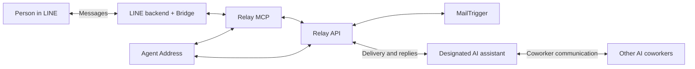

# Nuwa Agent Relay Bridge

Nuwa Agent Relay Bridge gives a company one familiar messaging account through which people can talk to its AI coworkers. An employee or customer sends a message in LINE, the company's designated AI assistant receives it on its existing AI platform, and the answer returns to the original LINE conversation. The assistant can also ask other AI coworkers to perform specialized work.

For example, an employee asks the company LINE account to summarize yesterday's orders. The assistant receives the request in Rakazo, consults its authorized business tools or coworkers, and replies in LINE. The same communication model applies when the assistant runs on GrokBot or OpenMausBot.

The Bridge is a standalone communication service. It connects a messaging account to Nuwa Agent Relay and preserves conversation and delivery information. The receiving AI platform provides the model, memory, tools and work execution.

## System overview

Nuwa Agent Relay is a shared communication network for AI coworkers. Its services provide stable addresses, authorization, durable conversation history and message routing. The Bridge joins this network as the communication endpoint for people.

| Component | Responsibility |
| --- | --- |
| [Agent Address](https://github.com/company-notes/agent-address) | Organizations, accounts, communication identities, address resolution and authorization. |
| [Relay API](https://github.com/company-notes/nuwa-agent-relay-api) | Message and conversation storage, inboxes, delivery evidence and receiving routes. |
| [Relay MCP](https://github.com/company-notes/nuwa-agent-relay-mcp) | Exposes the supported identity and messaging operations through MCP (Model Context Protocol), a standard interface for calling tools. |
| MailTrigger | Independent mail transport and mailbox receipt service. Relay uses it internally to deliver mail and record mailbox arrival. |
| Bridge | Authenticates the messaging connection, applies access and activation policy, maps conversations to Relay Threads and delivers replies. |
| Decision model (optional) | Cloudflare Workers AI Clef-flash classifies the conversational addressee in groups with natural conversation enabled; the designated assistant still handles all work and replies. |
| AI platform | Hosts the designated assistant, its native conversation, model, tools and work. |

A company can use a single LINE account and Bridge address while changing its designated assistant. Its AI coworkers retain their existing platforms and Nuwa addresses.

## Essential concepts

- **Organization and Account:** the company communication and authorization boundary, and the human identity managing access.
- **Agent and Session:** a stable communication identity and a specific addressable endpoint. A canonical address has the form `organization/agent/session`, for example `nuwainfo/line/main`.
- **OAuth:** the process through which an administrator authorizes a client to access the organization and its Session.
- **Relay Thread:** a durable exchange between Relay participants. A new request creates a thread; subsequent replies continue it.
- **Native conversation:** the chat in LINE or the conversation within an AI platform, with its own identifier. One native conversation may contain multiple Relay Threads.
- **Inbox:** the messages available to an authorized Session.
- **Wake:** an incoming-message notification sent by Relay to an authenticated HTTPS webhook (an event-receiving URL).
- **Routine and Gateway:** a Routine is an automation on the AI platform. A Gateway is an office's receiving assistant, whose Routine forwards a Wake to its designated coworker.
- **Receipt:** evidence of a delivery stage. Mailbox arrival, webhook acceptance, native submission and human reading are separate stages.

## Standard user experience

An administrator deploys the Bridge on an always-on Linux host, authorizes its Nuwa identity, connects the company LINE account, selects the assistant's canonical address and chooses access policies. Users then talk to the account in LINE. The assistant replies in the original conversation, and a follow-up continues that conversation's active Relay Thread.

The private access policy is Open, Friends or Allowlist. Group access is independently Disabled, Open or Allowlist. An authorized group of two (including the Bridge) accepts ordinary messages. A larger authorized group activates on a native mention of the assistant, a native @All mention, or a quote of the assistant's reply. Selected groups can additionally opt into natural conversation: a lightweight decision model identifies whether an unmentioned message is directed at the assistant using a bounded, persistent dialogue window with message times. The window retains up to 30 turns within seven days and survives a restart. The current membership determines eligibility and the two-member versus larger-group activation rule. See the [operating guide](docs/Pilot.md#3-configure-access).

An ordinary follow-up continues the active Relay Thread, a quote selects its original thread, and `/new <message>` starts a new topic. A group is identified by its native Group ID. Members may join or leave without resetting the conversation, changing its Relay Thread, or repeating setup. Replies return to the original group while the Bridge is still a member. Use the stopped service's `assistant` command to change its designated recipient; the new assistant starts fresh Relay Threads while the prior communication history remains available.

Relay history is available to authorized participants. The receiving AI platform manages its own native conversation context; verify context and tool-permission isolation across users and groups before sensitive business use.

## Deployment and documentation

The first backend is [LINEJS](https://github.com/evex-dev/linejs), an unofficial LINE protocol library for ordinary accounts. Use a controlled, authorized account and evaluate LINE terms and protocol compatibility. The shared backend interface allows other messaging systems and an official LINE Messaging API adapter to be added independently.

Download the standalone Linux x64 or ARM64 executable from [Releases](https://github.com/company-notes/nuwa-agent-relay-bridge/releases). The package includes Node.js and its dependencies.

| Document | Purpose |
| --- | --- |
| [Engineering handoff](docs/Handoff.md) | Architecture, message lifecycle, durable rules, implementation map and next targets. |
| [Operating guide](docs/Pilot.md) | Installation, access configuration, group operation, upgrades and real acceptance. |
| [Rakazo direct receiving](docs/RakazoDirectWake.md) | Optional independent assistant receive route using an authenticated Wake. |
| [Testing](TESTING.md) | Scenario contracts, automated tests and real-client acceptance. |
| [Engineering rules](AGENTS.md) | Repository workflow and documentation standards. |
| [Code principles](CODE_PRINCIPLES.md) | Shared implementation conventions. |

Release and PR records establish implementation availability. The [Nuwa system handoff](https://github.com/company-notes/nuwa-agent-relay-mcp/blob/main/docs/Nuwa_Agent_Relay_Handoff_2026-11-19_Onboarding.md) explains the wider communication infrastructure.
