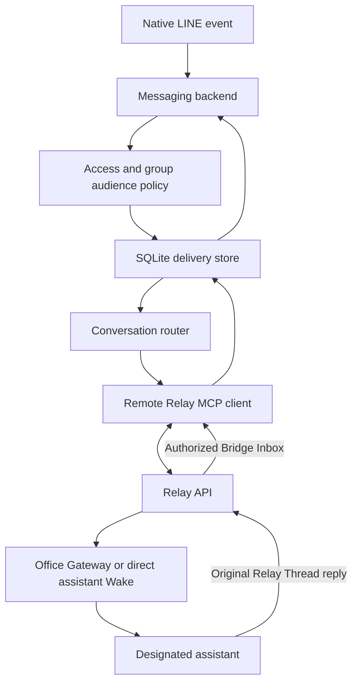

# Nuwa Agent Relay Bridge — Engineering Handoff

## 1. Purpose and reading order

A company exposes one messaging account, such as 小媧｜女媧資訊 in LINE, through which people can ask its AI team questions and assign work. The Bridge delivers those requests to a designated AI assistant and returns its answers to the originating chat. The assistant can collaborate with other AI coworkers through Nuwa.

Start with the [README](../README.md) for the product, component definitions and overall architecture. This guide explains the standard technical design and the next implementation targets. The [operating guide](Pilot.md) covers released behavior; [TESTING.md](../TESTING.md) defines acceptance.

## 2. Architecture and ownership

The Bridge is a small standalone TypeScript service using Node.js. It owns the messaging account connection and local conversation routing. Nuwa Agent Relay owns durable messages, address resolution and authorized receiving routes. The AI platform owns the assistant's intelligence, native conversation and business-tool authorization.

The Bridge uses Remote MCP as an authenticated client. Its own Agent and Session identify it in Nuwa; the LINE account and sender identifiers establish the human origin inside the messaging system. Human sender metadata is descriptive, not an independent Nuwa authorization grant.

The Relay API internally uses MailTrigger, an independent mail transport and mailbox receipt service. Its mailbox receipt establishes arrival at that stage. The AI assistant's platform receives a Wake (authenticated webhook event), and an office Gateway forwards it to the specified native Bot. An independently connected assistant can receive its own direct Wake. Both routes use the same assistant address and reply contract.

## 3. Identity and conversation model

| Identity or record | Scope |
| --- | --- |
| Bridge canonical address | One stable Nuwa Session per deployed Bridge account. |
| Native account ID | The authenticated LINE account owned by the organization. |
| Native conversation ID | A private chat keyed by the sender ID, or a group keyed by its native group ID. |
| Native message ID | Unique inbound event or outgoing LINE submission. |
| Relay Message ID | The durable message identifier in Nuwa. |
| Relay Thread ID | One exchange between the Bridge and a specific AI participant. |
| Group audience | The verified set of native group members, represented by a hash of sorted member IDs. |

A private chat and a group have separate routes, even when the same human participates in both. Each chat has an active Relay Thread. A new topic creates another thread; an explicit quote selects the matching thread in the same chat. The group audience belongs to the thread at the time of submission. Changes to the audience create a new thread and protect earlier messages and delayed replies from disclosure to the changed membership.

Relay stores the communication history. The platform's native conversation is a separate context boundary. The recipient can retrieve authorized Relay history when necessary. A common Bridge Session alone cannot enforce per-human AI context or business-tool isolation. Before public or sensitive use, demonstrate these protections in the receiving platform and apply permissions outside model prompts.

## 4. Standard message lifecycle

### Human to assistant

1. Receive a normalized native event from the authenticated backend.
2. Apply the appropriate private or group access policy and conversation activation rule.
3. Persist the inbound event and a unique submission ID in the local SQLite store.
4. Select the active Relay Thread, quoted thread or new topic; persist the exact submission plan.
5. Submit through `sendToAgent` for a new thread or `relayReplyThread` for a continuation. Preserve original body and supported artifact links.
6. Record the returned Message and Thread IDs and native correlation.

### Assistant to human

1. Retrieve replies through the Bridge's authenticated Inbox.
2. Match the recipient Session, designated assistant Session and known thread route.
3. Recheck current private authorization or the verified group audience.
4. Atomically claim the Relay Message ID for native delivery.
5. Send to the original native conversation and record the returned native message ID.

A native submission acknowledgment is evidence of submission, and a real LINE conversation establishes user-visible delivery. Keep Relay acceptance, MailTrigger receipt, Wake acceptance, native delivery and reading evidence distinct.

## 5. Durable implementation rules

- **Access:** Private Open accepts delivered private chats; Friends uses the company account's actual contact directory excluding blocked contacts; Allowlist uses selected contact IDs. Group access is independent. Group Open still requires verified membership; Allowlist approves a group and its member set. Invitations and former membership confer no access.
- **Group validation:** Verify the joined-group directory, matching group ID, explicit member map and presence of the Bridge and sender. LINE's chat-type discriminator can differ from the user-visible group type (including ROOM). Use the verified native identity and membership, not the discriminator alone. Include actual sender metadata in forwarded group messages.
- **Routing:** Authorize quote targets within the same native chat. Protect earlier group threads against membership changes. Validate the reply sender and original route before native delivery.
- **Retry:** Persist a unique inbound event and submission ID; a confirmed pre-submission retry reuses that plan. An ambiguous native send stays uncertain until reconciled using actual evidence. Duplicate events and restarts preserve the same processing identity.
- **Process lifecycle:** One process owns the private data directory. Use the OS-managed `flock` lock; its file remains in place and the operating system releases the lock on termination. Preserve local identity, login and delivery state across upgrades.
- **Credentials and diagnostics:** Keep OAuth and LINE login material in protected local storage. Logs contain stages, IDs, safe error categories and member counts rather than secrets or message bodies.
- **Receiving:** Use the published Remote MCP contract. The current pilot polls its bounded Inbox; a full window without a known checkpoint requires reconciliation. Durable event replay is the long-term receive mechanism.
- **Content:** Text and quotes carry their original contents. Public LINE sticker links can be included as Relay artifact links. Private image, audio, video and file events currently carry type notices; authorized transfer of private bytes is a separate capability.

## 6. Implementation map

| Area | Modules |
| --- | --- |
| CLI and deployment lifecycle | `Main.ts`, `BridgeConfiguration.ts`, `ProcessLock.ts`, `PrivateJSON.ts` |
| Authorization and Relay transport | `OAuthCredentials.ts`, `RemoteRelayClient.ts`, `Contracts.ts` |
| Messaging backend | `LineBackend.ts`, `LineStorage.ts`, `LineLoginPrompt.ts`, `LineMessage.ts` |
| Access and native directories | `AccessPolicy.ts`, `AccessSetup.ts`, `LineContactDirectory.ts`, `GroupPolicy.ts`, `GroupSetup.ts`, `LineGroupDirectory.ts` |
| Conversation and delivery | `Bridge.ts`, `ConversationAddress.ts`, `ConversationRouter.ts`, `DeliveryStore.ts` |
| Packaging and verification | `scripts/`, `test/`, `.github/workflows/` |

Backend modules own protocol-specific behavior and produce normalized events; the Bridge core owns the common lifecycle. Keep platform-specific operations behind the backend and Relay interfaces.

## 7. Next implementation targets

These are design requirements for the next version, not commands or behaviors available in the current release.

### Change the designated assistant

Provide an `assistant` command that displays the current canonical address, resolves the new assistant in the same organization, verifies its receiving identity and saves the change with the service stopped. For example, `nuwainfo/line/main` can change its destination from `nuwainfo/chief/main` to `nuwainfo/ava/main`.

Preserve OAuth, the LINE account, private/group policies, historical routes and delivery evidence. Start a fresh active Relay Thread for each native conversation when its designated assistant changes. Scope active threads, quotes and reply authorization to the appropriate assistant. Define and test the old assistant's pending and delayed deliveries before migration; the standard cutover should reconcile pending submissions and retain their original recipient. A quoted historical conversation must never silently route a new request to the former assistant. Configuration and SQLite binding changes must be crash-recoverable. The present database binds the designated recipient along with the Bridge identity, so an authorized migration is required.

### Group activation by audience size

Use deterministic native membership rather than model-based relevance classification:

| Verified conversation | Activation |
| --- | --- |
| Authorized private chat | Ordinary incoming messages. |
| Authorized group of two, including the Bridge | Ordinary incoming messages from the other member. |
| Authorized group of three or more | Native mention of the assistant or quote of its previous reply. |

A current membership change updates the activation rule and starts a separate Relay Thread; Allowlist membership changes require fresh approval. Self-generated messages and a standalone @Everyone do not activate the assistant. Check the same audience used for authorization and activation before submission. Preserve group and private separation.

### Operational and context acceptance

Validate real two-member and larger groups, a change of designated assistant, interleaved private and group chats, and group member changes. Verify the receiving AI's context with distinct harmless markers in separate conversations. Plan systemd (the Linux service manager) integration for automatic startup and restart, and durable Inbox event replay for longer offline intervals. Feature availability is established through tests and released artifacts.

## 8. Engineering workflow and entry points

Read [AGENTS.md](../AGENTS.md), [CODE_PRINCIPLES.md](../CODE_PRINCIPLES.md) and [TESTING.md](../TESTING.md). Use scenario-based regression tests, real SQLite state, native x64/ARM64 packaging and live LINE acceptance. Review Rule 20 semantic spacing after functional tests, then rerun checks.

The [official Skill](https://mcp.agent-relay.company-notes.com/skills/nuwa-agent-relay/SKILL.md) defines the receiving assistant and Gateway contracts. The [wider system handoff](https://github.com/company-notes/nuwa-agent-relay-mcp/blob/main/docs/Nuwa_Agent_Relay_Handoff_2026-11-19_Onboarding.md) explains Nuwa services and platform integration. Keep implementation history and dated acceptance evidence in [issues](https://github.com/company-notes/nuwa-agent-relay-bridge/issues), [PRs](https://github.com/company-notes/nuwa-agent-relay-bridge/pulls) and [releases](https://github.com/company-notes/nuwa-agent-relay-bridge/releases).
