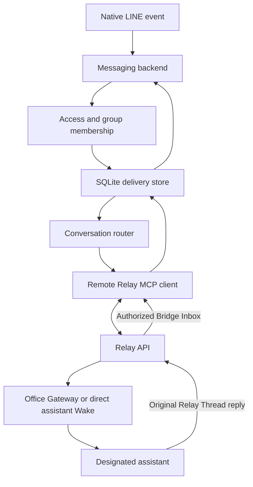

# Nuwa Agent Relay Bridge — Engineering Handoff

## 1. Purpose and reading order

A company exposes one messaging account, such as 小媧｜女媧資訊 in LINE, through which people can ask its AI team questions and assign work. The Bridge delivers those requests to a designated AI assistant and returns its answers to the originating chat. The assistant can collaborate with other AI coworkers through Nuwa.

Start with the [README](../README.md) for the product, component definitions and overall architecture. This guide explains the standard technical design and operating contracts. The [operating guide](Pilot.md) covers operator commands; [TESTING.md](../TESTING.md) defines acceptance.

## 2. Architecture and ownership

The Bridge is a small standalone TypeScript service using Node.js. It owns the messaging account connection and local conversation routing. Nuwa Agent Relay owns durable messages, address resolution and authorized receiving routes. The AI platform owns the assistant's intelligence, native conversation and business-tool authorization.

The Bridge uses Remote MCP as an authenticated client. Its own Agent and Session identify it in Nuwa; the LINE account and sender identifiers establish the human origin inside the messaging system. Human sender metadata is descriptive, not an independent Nuwa authorization grant.

The Relay API internally uses MailTrigger, an independent mail transport and mailbox receipt service. Its mailbox receipt establishes arrival at that stage. The AI assistant's platform receives a Wake (authenticated webhook event), and an office Gateway forwards it to the specified native Bot. An independently connected assistant can receive its own direct Wake. Both routes use the same assistant address and reply contract.

## 3. Identity and conversation model

| Identity or record | Scope |
| --- | --- |
| Bridge canonical address | One stable Nuwa Session per deployed Bridge account. |
| Native account ID | The authenticated LINE account owned by the organization. |
| Native conversation ID | A private chat keyed by the sender ID, or a group keyed by its native group ID. |
| Native message ID | Unique inbound event or outgoing LINE submission. |
| Relay Message ID | The durable message identifier in Nuwa. |
| Relay Thread ID | One exchange between the Bridge and a specific AI participant. |
| Group membership | The current native member list, used to verify participation and determine the activation rule. |

A private chat and a group have separate routes, even when the same human participates in both. Each chat has an active Relay Thread. A new topic creates another thread; an explicit quote selects the matching thread in the same chat. Group identity remains stable as people join and leave. Conversation history, settings, quotes and replies continue to use that Group ID and the current assistant generation.

Relay stores the communication history. The platform's native conversation is a separate context boundary. The recipient can retrieve authorized Relay history when necessary. A common Bridge Session alone cannot enforce per-human AI context or business-tool isolation. Before public or sensitive use, demonstrate these protections in the receiving platform and apply permissions outside model prompts.

## 4. Standard message lifecycle

### Human to assistant

1. Receive a normalized native event from the authenticated backend.
2. Apply the appropriate private or group access policy and conversation activation rule.
3. Persist the inbound event and a unique submission ID in the local SQLite store.
4. Select the active Relay Thread, quoted thread or new topic; persist the exact submission plan.
5. Submit through `sendToAgent` for a new thread or `relayReplyThread` for a continuation. Preserve original body and supported artifact links.
6. Record the returned Message and Thread IDs and native correlation.

### Assistant to human

1. Retrieve replies through the Bridge's authenticated Inbox.
2. Match the recipient Session, designated assistant Session and known thread route.
3. Recheck current private authorization or the Bridge's membership in the original group.
4. Atomically claim the Relay Message ID for native delivery.
5. Send to the original native conversation and record the returned native message ID.

A native submission acknowledgment is evidence of submission, and a real LINE conversation establishes user-visible delivery. Keep Relay acceptance, MailTrigger receipt, Wake acceptance, native delivery and reading evidence distinct.

## 5. Durable implementation rules

- **Access:** Private Open accepts delivered private chats; Friends uses the company account's actual contact directory excluding blocked contacts; Allowlist uses selected contact IDs. Group access is independent. Group Open includes all joined groups; Allowlist selects groups by Group ID. The Bridge verifies actual membership before handling requests and sending replies.
- **Group validation:** Verify the joined-group directory, matching group ID, explicit member map and presence of the Bridge and sender. LINE's chat-type discriminator can differ from the user-visible group type (including ROOM). Use the verified native identity and membership, not the discriminator alone. Include actual sender metadata in forwarded group messages.
- **Routing:** Authorize quote targets within the same native chat and assistant generation. Validate the reply sender and original route before native delivery. Accepted group requests and delayed replies continue through ordinary member changes while the Bridge remains a member.
- **Retry:** Persist a unique inbound event and submission ID; a confirmed pre-submission retry reuses that plan. An ambiguous native send stays uncertain until reconciled using actual evidence. Duplicate events and restarts preserve the same processing identity.
- **Process lifecycle:** One process owns the private data directory. Use the OS-managed `flock` lock; its file remains in place and the operating system releases the lock on termination. Preserve local identity, login and delivery state across upgrades.
- **Credentials and diagnostics:** Keep OAuth and LINE login material in protected local storage. Logs contain stages, IDs, safe error categories and member counts rather than secrets or message bodies.
- **Receiving:** Use the published Remote MCP contract. The current pilot polls its bounded Inbox; a full window without a known checkpoint requires reconciliation. Durable event replay is the long-term receive mechanism.
- **Content:** Text and quotes carry their original contents. Public LINE sticker links can be included as Relay artifact links. Private image, audio, video and file events currently carry type notices; authorized transfer of private bytes is a separate capability.

## 6. Implementation map

| Area | Modules |
| --- | --- |
| CLI and deployment lifecycle | `Main.ts`, `BridgeConfiguration.ts`, `ProcessLock.ts`, `PrivateJSON.ts` |
| Authorization and Relay transport | `OAuthCredentials.ts`, `RemoteRelayClient.ts`, `Contracts.ts` |
| Messaging backend | `LineBackend.ts`, `LineStorage.ts`, `LineLoginPrompt.ts`, `LineMessage.ts` |
| Access and native directories | `AccessPolicy.ts`, `AccessSetup.ts`, `LineContactDirectory.ts`, `GroupPolicy.ts`, `GroupSetup.ts`, `LineGroupDirectory.ts` |
| Natural conversation | `ConversationHistory.ts`, `ConversationWindow.ts`, `ConversationDecision.ts`, `ClefDecisionModel.ts`, `GroupActivationPolicy.ts`, `ConversationSetup.ts` |
| Conversation and delivery | `Bridge.ts`, `ConversationAddress.ts`, `ConversationRouter.ts`, `DeliveryStore.ts` |
| Packaging and verification | `scripts/`, `test/`, `.github/workflows/` |

Backend modules own protocol-specific behavior and produce normalized events; the Bridge core owns the common lifecycle. Keep platform-specific operations behind the backend and Relay interfaces.

## 7. Assistant selection and group activation

### Change the designated assistant

The `assistant` command displays the current canonical address, resolves the new assistant in the same organization, and saves the confirmed change with the service stopped. Verify the selected assistant's receiving route through a real round trip. For example, `nuwainfo/line/main` can change its destination from `nuwainfo/chief/main` to `nuwainfo/ava/main`.

The cutover preserves OAuth, the LINE account, private/group policies, historical routes and delivery evidence. Complete pending submissions and reconcile uncertain native deliveries before confirming. Each cutover advances a persisted assistant generation (the routing epoch); new conversations start fresh Relay Threads, including when returning to an earlier assistant. Historical quotes cannot select an earlier generation. Delayed replies from earlier generations remain recorded in Relay and are blocked from LINE delivery after cutover. A durable SQLite switch intent, atomic configuration rename and startup reconciliation preserve consistency across interruption. A versioned database identity prevents an older executable from bypassing generation isolation.

### Group activation by membership size

Use deterministic native membership and explicit addressing first; selected groups may enable natural addressee classification:

| Verified conversation | Activation |
| --- | --- |
| Authorized private chat | Ordinary incoming messages. |
| Authorized group of two, including the Bridge | Ordinary incoming messages from the other member. |
| Authorized group of three or more | Native mention of the assistant, native @All, quote of its previous reply, or a positive natural-conversation decision. |

The current member count updates the activation rule while preserving the active Relay Thread and natural conversation window. Self-generated messages remain local. Native @All addresses every member including the assistant. Verify the sender and Bridge membership at intake, and the Bridge's membership before submission or reply. Unaddressed larger-group chatter stays local; groups with natural conversation enabled retain bounded recent text in the private SQLite database. The same Group ID retains its settings as people join or leave. Different groups and private conversations remain separate.

### Natural conversation

GroupActivationPolicy owns deterministic activation, per-group feature settings, eligibility, the decision threshold and cooldown. ConversationHistory owns SQLite persistence, group and assistant-generation isolation, expiry and capacity bounds. ConversationWindow prepares the bounded dialogue with local speaker labels and observation timestamps. ClefDecisionModel implements the replaceable ConversationDecision interface and authenticates the Workers AI HTTP request. ConversationRouter attaches the accepted context as external dialogue data; DeliveryStore preserves the exact accepted snapshot and submission plan across retries. The designated assistant alone interprets the request and executes work.

Natural activation requires an enabled group, an eligible short message, the assistant's participation anywhere in the retained window or its visible name, and probability >= 0.8. Explicit native addressing bypasses inference, while an explicit mention of another member or quote directed elsewhere suppresses inference. The same Group ID and assistant generation retain dialogue across restarts and membership changes. Disabling natural conversation, removing group access or switching assistants removes affected rolling history. Accepted contextual requests retain their submission snapshot for retry while the group remains enabled and the Bridge is a member. No model call can override group access, recipient identity, thread routing or tool authorization. Accepted snapshots become part of Relay history and retain normal delivery-record semantics. The model has no business tools.

The initial pilot uses Clef-flash with a 2.5-second HTTP timeout, 30-second failure cooldown, at most 64 group windows, 30 turns per group and seven days of age. Time is evidence for addressee classification rather than a short conversation cutoff. Expired window rows are removed on startup and during normal operation. Accepted delivery snapshots retain ordinary delivery-record semantics independently of the window. Only acknowledged native assistant replies enter the window. Text is bounded to 500 characters per turn plus a truncation marker; the model receives UTC observation timestamps and uses time gaps and intervening dialogue to assess topic continuity. The service records only events it observes; prior unavailable history is not reconstructed. longer latest messages require explicit activation. The design favors avoiding unsolicited replies; model accuracy and latency depend on real dialogue and service availability. Use [operator configuration](Pilot.md#natural-group-conversation-optional) to enable it.

### Existing installation upgrades

The upgrade converts roster-based selections to stable Group IDs, removes superseded audience metadata from the local database, and preserves native chat routes, Relay Thread IDs, assistant generations, pending submission plans and retained dialogue. The database identity version prevents older executables from using the migrated database. Historical blocked records remain historical evidence; previously discarded messages are not reconstructed. Back up the data directory before upgrading.

### Operational and context acceptance

Validate real two-member and larger groups, a change of designated assistant, interleaved private and group chats, and group member changes. Verify the receiving AI's context with distinct harmless markers in separate conversations. A user-level systemd (Linux service manager) unit is provided in the [operating guide](Pilot.md#6-run-as-a-background-service); its behavior on the target host requires acceptance. Durable Inbox event replay for longer offline intervals remains a separate implementation target.

## 8. Engineering workflow and entry points

Read [AGENTS.md](../AGENTS.md), [CODE_PRINCIPLES.md](../CODE_PRINCIPLES.md) and [TESTING.md](../TESTING.md). Use scenario-based regression tests, real SQLite state, native x64/ARM64 packaging and live LINE acceptance. Review Rule 20 semantic spacing after functional tests, then rerun checks.

The [official Skill](https://mcp.agent-relay.company-notes.com/skills/nuwa-agent-relay/SKILL.md) defines the receiving assistant and Gateway contracts. The [wider system handoff](https://github.com/company-notes/nuwa-agent-relay-mcp/blob/main/docs/Nuwa_Agent_Relay_Handoff_2026-11-19_Onboarding.md) explains Nuwa services and platform integration. Keep implementation history and dated acceptance evidence in [issues](https://github.com/company-notes/nuwa-agent-relay-bridge/issues), [PRs](https://github.com/company-notes/nuwa-agent-relay-bridge/pulls) and [releases](https://github.com/company-notes/nuwa-agent-relay-bridge/releases).
